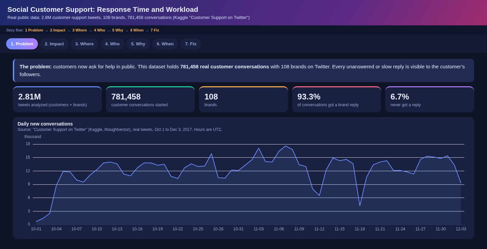

# Customer Support on Twitter: Response Time and Workload

## [Open the live dashboard](https://anas-abdelhafeez.github.io/customer-support-twitter-analysis/)

<a href="https://anas-abdelhafeez.github.io/customer-support-twitter-analysis/"></a>

https://anas-abdelhafeez.github.io/customer-support-twitter-analysis/

A Python analysis of 2.81 million real customer-support tweets across 108 brands: how long customers wait for a first reply, who answers fast, and when the pressure peaks. It ships a 7-tab dashboard and **Tableau-ready extracts** (CSV and a `.hyper` file) so the same numbers can be rebuilt in Tableau.


## Headline findings

- **781,458** customer conversations (Oct 1 to Dec 3, 2017); **93.3%** got a brand reply, **52,139** did not.
- Median first response is **24.3 minutes**, but the mean is **4.4 hours**: the slowest 10% wait **546 minutes or more** (p90) and the p99 is **4,472 minutes**.
- **64.6%** are answered within 1 hour, **82.6%** within 4 hours.
- Among the 20 busiest brands the median wait ranges from 2.6 minutes (TMobileHelp) to 757 minutes (hulu_support).
- Demand peaks in the evening (15:00 to 20:59 UTC holds 34% of conversations). The **median wait barely moves by hour, but the p90 tail is longest overnight and around 20:00 UTC.**

## Repo layout

| Path | What it is |
| --- | --- |
| `analysis.py` | DuckDB pipeline: raw tweets to conversations, first reply, summary tables, Tableau extracts |
| `build_dashboard.py`, `dashboard_lib.py` | Builds the dark, 7-tab HTML dashboard from the extracts |
| `extracts/*.csv` | Tableau-ready tables (brand summary, daily volume, hour x weekday, FRT buckets, FRT by hour, brand x hour) |
| `extracts/support_extracts.hyper` | The same tables as one Tableau Hyper extract |
| `results.json` | Headline numbers used by the dashboard |
| `TABLEAU.md` | Step-by-step guide to build the Tableau workbook from the extracts |
| `DATA.md` | Source, definitions, limits |
| `tests/` | Unit tests for the first-response logic |
| `docs/` | Dashboard and screenshots |

## Run it

```bash
pip install -r requirements.txt
# download twcs.csv from Kaggle: "Customer Support on Twitter"
python analysis.py --csv path/to/twcs.csv
python build_dashboard.py
pytest
```

The full analysis runs in about 20 seconds on a laptop.

## Story flow

Problem, Impact, Where, Who, Why, When, Fix. Each tab opens with the finding, then the chart, then what it means.

## Honest limits

- The data covers 64 days in late 2017. It shows no seasonality and may not match today's behaviour.
- The dataset has no queue, staffing or resolution fields. It shows **when** waits are long, not **why**, and cannot say whether a reply solved the problem.
- First response time is measured to the first brand reply to the opening tweet. Replies sent by direct message are not visible.
- Hours are UTC; customers are mostly in the US and UK, so local-time peaks differ.

## License

MIT for code. Data: Kaggle dataset "Customer Support on Twitter" (see DATA.md).
